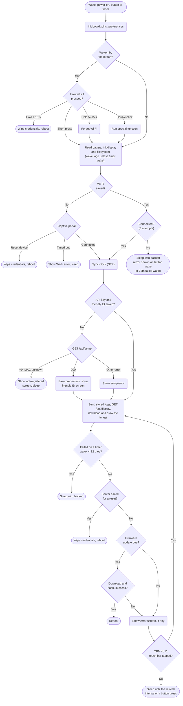

# TRMNL firmware <-> server HTTP API reference

Reference documentation for the HTTP API between TRMNL e-ink devices (the official firmware) and the
server they talk to. It is written so that a compatible self-hosted ("BYOS") server can be
implemented from these pages alone.

| | |
|---|---|
| **Target firmware** | **v1.8.19** (GitHub release `v1.8.19`, published 2026-11-13T14:37:22Z, not a pre-release) |
| **Tag commit** | `450f9ca2c690ef8bf7d9f5a219b71fd49301325d` (committed 2026-11-13 09:09:50 -0500) |
| **Firmware repository** | https://github.com/usetrmnl/trmnl-firmware (`github.com/usetrmnl/firmware` redirects here) |
| **Date checked** | **2026-11-16** |
| **Ground truth** | The source code at tag `v1.8.19`. Where official documentation disagrees with the code, these pages follow the code and say so (see [discrepancies](10-discrepancies-and-open-questions.md)). |

How the target was chosen: `GET https://api.github.com/repos/usetrmnl/firmware/releases` (and `/releases/latest`)
on 2026-11-16 lists `v1.8.19` (2026-11-13) first, with `prerelease: false` and `draft: false`. The next
ones are `v1.8.18` (2026-10-30) and `v1.8.17` (2026-10-02). No pre-release or beta is newer.
The release has no attached binaries; the OTA binaries are published by TRMNL elsewhere
(see [firmware-update-and-reset](07-firmware-update-and-reset.md)).

> Note: TRMNL's own OTA channel (`GET https://trmnl.com/api/firmware`, checked 2026-11-16) still
> lists **1.8.18** as `latest` for every model. A device that is fed firmware by TRMNL's cloud is
> therefore one release behind this documentation target. Comparing the tags `v1.8.18` and `v1.8.19`
> (`git diff`), the changes that touch the server API are all additive:
> new request headers `Reset-Reason`, `Panel-Vcom` and `Log-Level`; a new optional response field
> `verbose_logging`; the new special function `toggle_hold`; `screen_wiper` is now matched as a
> filename **prefix** (it was the exact name `screen_wiper.png`); and a `rewind` request may be answered
> with `action: "guest_mode"` plus an image. A server written for these pages also works with 1.8.18, which simply
> does not send or read those items.

## Pages

| Page | What it covers |
|---|---|
| [01 Overview and device lifecycle](01-overview-and-lifecycle.md) | The full list of endpoints the firmware calls, the wake cycle step by step, first boot, registration, sleep and refresh timing |
| [02 `GET /api/setup`](02-api-setup.md) | Registration: trade a MAC address for an API key |
| [03 `GET /api/display`](03-api-display.md) | The main loop: every request header, every response field, status codes, examples |
| [04 `POST /api/log`](04-api-log.md) | Log upload: payload format, which logs are sent, retry semantics |
| [05 Images and caching](05-images-and-caching.md) | Image formats, sizes, bit depth, palettes per model, `filename` caching, download rules |
| [06 Special functions](06-special-functions.md) | `identify`, `sleep`, `add_wifi`, `restart_playlist`, `rewind`, `send_to_me`, `guest_mode`, `toggle_hold`; the `action` handshake |
| [07 Firmware update and reset](07-firmware-update-and-reset.md) | `update_firmware` / `firmware_url`, `reset_firmware`, `status: 500` |
| [08 Provisioning and transport](08-provisioning-and-transport.md) | Captive portal, how the server URL is set, HTTP vs HTTPS, redirects, timeouts, NTP, proxies |
| [09 Errors and retries](09-errors-and-retries.md) | What the device does and shows for each failure, retry/backoff tables |
| [10 Discrepancies and open questions](10-discrepancies-and-open-questions.md) | Where docs and code disagree, and everything that could not be verified |
| [11 Cross-check against server implementations](11-implementation-cross-check.md) | LaraPaper, Terminus (byos_hanami), byos_next compared with the firmware; a conformance checklist |

## The minimum a server must do (summary)

1. `GET /api/setup` with header `ID: <MAC>`: answer JSON `{"status":200,"api_key":"...","friendly_id":"...","image_url":"...","message":"..."}`,
   or HTTP 404 (or JSON `status: 404`) if the MAC is not known.
2. `GET /api/display` with headers `ID` and `Access-Token`: answer JSON with `status: 0`, `image_url`,
   `filename`, `refresh_rate` (number of seconds), plus `reset_firmware`/`update_firmware`/`firmware_url`/`special_function`.
3. Serve the image at `image_url` as PNG (`Content-Type: image/png` exactly), JPEG, or (800x480 devices only) a
   1-bit BMP, at exactly the size the device reported in the `Width`/`Height` headers.
4. Accept `POST /api/log` with `{"logs":[...]}` and answer 200 or 204.
5. Change `filename` only when the picture changes; the device uses it as a cache key.

Everything else in these pages is detail, edge cases and corner cases of those five points.

## Conventions

- "The device" means a device running firmware v1.8.19. Board families: **OG** (ESP32-C3, 800x480, `Model: og`),
  **OG gen 2** (ESP32-C5), **BWRY** (4-colour OG), **X** (ESP32-S3 + ESP32-C5 modem, 1872x1404, 16 grays, `Model: x`),
  and many "BYOD" boards built from the same source tree (see [05](05-images-and-caching.md#models-and-panel-sizes)).
- Code references look like `src/display_session.cpp` and are relative to the firmware repository at tag `v1.8.19`:
  `https://github.com/usetrmnl/trmnl-firmware/blob/v1.8.19/<path>`.
- Blocks marked **Official documentation (copied)** are taken near-verbatim from the cited URL. A
  **Correction** note below such a block says where it is wrong or incomplete for v1.8.19.
- **Unverified** marks anything that could not be confirmed from the v1.8.19 source (or from an actual device).
  Nothing is stated as fact if it is only a guess; guesses are labelled.
- JSON examples are illustrative; header and field names are exact.
- HTTP header names are case-insensitive on the wire, but the firmware sends them in the exact case shown, and
  one of them, `special_function`, contains an **underscore** (see [06](06-special-functions.md)).

## Official wake-cycle documentation (copied)

Source: https://github.com/usetrmnl/trmnl-firmware/blob/v1.8.19/README.md ("Wake cycle" and "Web Server Endpoints").

> Each wake the device connects to Wi-Fi, fetches its screen from `/api/display`, draws it, checks for a reset or firmware update and goes back to deep sleep.
>
> The device talks to its server through three endpoints: `GET /api/setup`, `GET /api/display` and `POST /api/log`. The [BYOS guide](https://docs.trmnl.com/go/diy/byos#api) documents the request headers, every field the firmware reads, the filename rules and the image size + format for each model.

Flowchart from the same README (verbatim):

> **Correction / precision (v1.8.19):** the flowchart's "Setup -> Other error -> Show setup error -> Fetch" branch
> means that after a failed `/api/setup` the device still calls `/api/display`, with an **empty `Access-Token`**
> (the key was never stored). A server that answers an unknown token with `status: 500` or `reset_firmware: true`
> makes the device wipe its Wi-Fi settings. See [02](02-api-setup.md#failure-handling) and [07](07-firmware-update-and-reset.md).

## Sources

- Firmware source at tag `v1.8.19` (primary): https://github.com/usetrmnl/trmnl-firmware/tree/v1.8.19
- Firmware README (copied above): https://github.com/usetrmnl/trmnl-firmware/blob/v1.8.19/README.md
- GitHub releases API (target selection): https://api.github.com/repos/usetrmnl/firmware/releases
- TRMNL OTA channel listing: https://trmnl.com/api/firmware
- Official BYOS documentation: https://docs.trmnl.com/go/diy/byos (Markdown: https://docs.trmnl.com/go/diy/byos.md)
